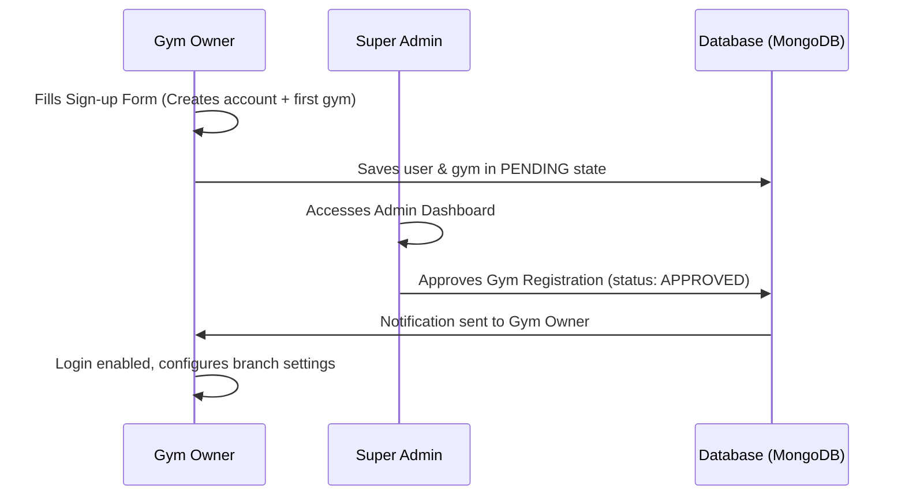
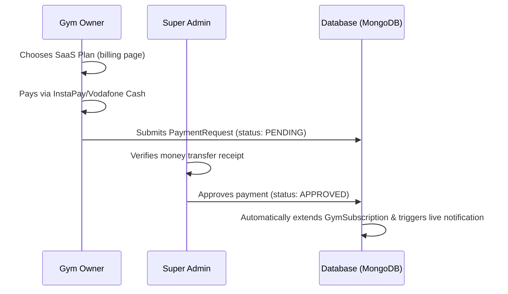

# GymTank 🏋️‍♂️📦

[](https://nextjs.org/)
[](https://react.dev/)
[](https://www.typescriptlang.org/)
[](https://tailwindcss.com/)
[](https://www.prisma.io/)
[](https://www.mongodb.com/)

An enterprise-grade, multi-tenant SaaS (Software as a Service) platform designed for gym owners and administrators. **GymTank** enables gym owners to manage branches, track member attendance and occupancy dynamically, handle billing subscriptions, and manage membership packages. It also provides a robust Super Admin dashboard to approve new gyms, verify payments, manage global system settings, and audit logs.

---

## 📖 Table of Contents / جدول المحتويات
* [English Version](#english-version)
  * [Features](#-features)
  * [Architecture & Flow](#-architecture--flow)
  * [Tech Stack](#%EF%B8%8F-tech-stack)
  * [Directory Structure](#-directory-structure)
  * [Getting Started](#-getting-started)
  * [Seed Admin Credentials](#-seed-admin-credentials)
* [النسخة العربية (Arabic Version)](#النسخة-العربية)
  * [المميزات الرئيسية](#-المميزات-الرئيسية)
  * [هيكلية العمل البرمجية](#-هيكلية-العمل-البرمجية)
  * [التقنيات المستخدمة](#-التقنيات-المستخدمة)
  * [دليل التشغيل المحلي](#-دليل-التشغيل-المحلي)
  * [بيانات الحساب الافتراضي للتجربة](#-بيانات-الحساب-الافتراضي-للتجربة)

---

# English Version

## 🌟 Features

### 👑 1. Super Admin Dashboard (`/admin`)
* **Real-time Metrics**: High-level view of active gyms, platform revenue, popular subscription plans, and pending support inquiries.
* **Gym Approval Process**: Review pending gym registration requests (`PENDING`, `APPROVED`, `REJECTED`, `SUSPENDED`).
* **Subscription & Payment Verification**: Inspect payment receipts submitted by gym owners (supporting Vodafone Cash, InstaPay, and Bank Transfers) to approve SaaS plan activations.
* **Support Ticket Center**: Manage and reply to system inquiry messages.
* **Platform Audit Trails**: Track security operations, administrative actions, and IP logs for full transparency.
* **System Settings Manager**: Configure global attributes such as VAT rates, currency symbols, SMTP credentials, default subscription limits, and maintenance mode.
* **Admin Notifications**: Send broadcast or targeted notifications to gym owners.

### 🏋️‍♂️ 2. Gym Owner Dashboard (`/user`)
* **Occupancy & Attendance Tracker**: Real-time capacity indicator displaying active gym occupancy relative to maximum branch capacity. Check members in and out dynamically.
* **Member Management**: Track active, expired, or paused memberships, register new members, assign subscription tiers, and log payment transactions.
* **Platform Billing**: Upgrade or renew SaaS subscription plans by submitting payment receipts to Super Admins.
* **Custom Config & Settings**: Customize gym preferences (currencies, languages), membership tiers (e.g., Standard, Premium, VIP), and pricing.

---

## 🔄 Architecture & Flow

### A. Gym Registration & Activation


### B. Billing & SaaS Plan Renewals


---

## 🛠️ Tech Stack

* **Framework:** Next.js (App Router, Server Actions, Hybrid Server/Client Components)
* **Database & ORM:** MongoDB, managed via Prisma ORM
* **Styling:** Tailwind CSS (v4)
* **Icons:** Lucide React
* **Authentication & Authorization:** Custom role-based session middleware (Admin, Gym Owner)
* **Formatting:** Native JavaScript `Intl` API for localized dates, currencies, and numbers

---

## 📂 Directory Structure

```bash
gym-tank/
├── prisma/                  # Prisma Database schema and seed configuration
│   ├── schema.prisma        # Database models & relationships
│   └── seed.ts              # Database seeding script (default admin creation)
├── public/                  # Static assets & public resources
└── src/
    ├── actions/             # Next.js Server Actions (API alternative)
    │   ├── admin/           # Administrative actions (settings, billing approval, etc.)
    │   └── user/            # Tenant/Gym Owner operations (attendance, members)
    ├── app/                 # Next.js App Router folders and routes
    │   ├── (auth)/          # Authentication pages (login, sign-up)
    │   ├── admin/           # Super Admin Panel
    │   └── user/            # Gym Owner Panel
    ├── components/          # Reusable UI component library
    ├── layouts/             # Shared layout structures (Navbar, Sidebars)
    ├── lib/                 # Shared library clients (e.g., Prisma client helper)
    ├── pages/               # Page wrapper components
    └── utils/               # Utility functions (date formatters, validators)
```

---

## 🚀 Getting Started

Follow these steps to run the project locally:

### 1. Clone & Install Dependencies
```bash
git clone https://github.com/Mohamed-Mos-aad/gym-tank.git
cd gym-tank
npm install
```

### 2. Configure Environment Variables
Create a `.env` file in the root directory and define your MongoDB connection string (see `.env.example`):
```env
DATABASE_URL="your-mongodb-connection-string"
```

### 3. Initialize Database Schema
Generate the Prisma Client and push the schema to MongoDB:
```bash
npx prisma db push
```

### 4. Run the Seed Script
Seed the database with the default Super Admin user:
```bash
npx prisma db seed
```

### 5. Start the Development Server
```bash
npm run dev
```
Open [http://localhost:3000](http://localhost:3000) in your browser to view the application.

---

## 🔐 Seed Admin Credentials

After running the database seed, log in with the following default Super Admin credentials:

* **Email:** `ma3268787@gmail.com`
* **Password:** `gymtank@3268787`

---

# النسخة العربية

منصة **جيم تانك (GymTank)** هي نظام إدارة صالات رياضية متعدد المشتركين (Multi-tenant SaaS Platform) مبني بأحدث التقنيات البرمجية لتسهيل الإدارة، المتابعة، والاشتراكات.

---

## 🌟 المميزات الرئيسية

### 👑 1. لوحة تحكم المشرف العام (Super Admin)
* **إحصائيات فورية**: متابعة الأندية الفعالة، الأرباح الكلية، الباقات الأكثر طلباً، وتذاكر الدعم الجديدة.
* **إدارة وقبول النوادي**: عرض طلبات تسجيل الأندية الجديدة والموافقة عليها أو رفضها وتجميد الفروع.
* **التحقق من الفواتير والاشتراكات**: مراجعة وإقرار طلبات الدفع وتجديد باقات الأندية المرفقة بإيصالات (Vodafone Cash, InstaPay, Bank Transfer).
* **مركز الدعم الفني**: عرض رسائل واستفسارات المستخدمين غير المسجلين والرد عليها.
* **سجل الرقابة والعمليات (Audit Log)**: سجل تفصيلي يوضح كل حركة وتعديل في النظام مع تسجيل عنوان الـ IP للأمان.
* **الإعدادات العامة للنظام**: تفعيل وضع الصيانة، إعدادات البريد الإلكتروني SMTP، وتعيين الضرائب وحدود الأمان للنوادي.

### 🏋️‍♂️ 2. لوحة تحكم صاحب النادي الرياضي (Gym Owner)
* **مؤشر السعة الاستيعابية والحضور**: مراقبة نسبة إشغال الصالة حالياً مقارنة بالسقف المسموح به، وتسجيل دخول/خروج الأعضاء ديناميكياً.
* **إدارة المشتركين**: إضافة الأعضاء الجدد، تجديد أو تجميد اشتراكاتهم، ومتابعة فواتير الدفع التفصيلية.
* **اشتراكات المنصة والفواتير**: اختيار باقة ترقية وتجديد الاشتراك، وإرسال بيانات التحويل (مثل Vodafone Cash أو InstaPay) للإدارة.
* **تخصيص الإعدادات**: تعديل عملة الفرع ولغته، وتصميم باقات الأعضاء وتحديد أسعارها (VIP، عادي، بريميوم).

---

## 🔄 هيكلية العمل البرمجية

### أ) تسجيل وتفعيل النادي الجديد
1. يقوم صاحب الجيم بملء استمارة التسجيل وإنشاء حساب مالك وتفاصيل الجيم.
2. يتم حفظ البيانات في قاعدة البيانات بوضعية معلقة (`PENDING`).
3. يقوم المشرف العام بفحص الطلب والموافقة عليه (`APPROVED`).
4. يتلقى صاحب الجيم إشعاراً فوريًا بنجاح التفعيل ويبدأ في استخدام لوحته الخاصة.

### ب) تجديد اشتراك الأندية
1. يختار صاحب النادي الباقة المناسبة من صفحة الفواتير.
2. يقوم بتحويل المبلغ وإدخال تفاصيل التحويل وصورة إثبات الدفع.
3. يظهر الطلب فوراً كطلب معلق في لوحة تحكم المشرف العام.
4. بمجرد تأكيد المشرف للتحويل المالي، يتم تحديث اشتراك النادي آلياً وتمديد صلاحية حسابه.

---

## 🛠️ التقنيات المستخدمة

* **إطار العمل:** Next.js (App Router, Server Actions, Server Components)
* **قاعدة البيانات ومحرك الاستعلامات:** MongoDB مع Prisma ORM
* **تنسيق الواجهات:** Tailwind CSS (v4)
* **الأيقونات:** المكتبة المتناسقة Lucide React
* **نظام الصلاحيات:** معالج وسيط (Middleware) مخصص للتحقق من هوية المشرفين وأصحاب النوادي.

---

## 🚀 دليل التشغيل المحلي

### 1. استنساخ المشروع وتثبيت المكتبات
```bash
git clone https://github.com/Mohamed-Mos-aad/gym-tank.git
cd gym-tank
npm install
```

### 2. إعداد متغيرات البيئة
قم بإنشاء ملف باسم `.env` في المسار الرئيسي للمشروع، وقم بكتابة رابط الاتصال بقاعدة بيانات MongoDB الخاصة بك (راجع `.env.example` كنموذج):
```env
DATABASE_URL="رابط-قاعدة-بيانات-المونجو"
```

### 3. رفع وتحديث جداول قاعدة البيانات
```bash
npx prisma db push
```

### 4. تشغيل البث الأولي للبيانات (Seeding)
لتجهيز حساب المشرف العام الافتراضي:
```bash
npx prisma db seed
```

### 5. تشغيل السيرفر المحلي للتطوير
```bash
npm run dev
```
تصفح التطبيق الآن عبر الرابط المحلي [http://localhost:3000](http://localhost:3000).

---

## 🔐 بيانات الحساب الافتراضي للتجربة

بعد تشغيل كود البث الأولي (Seed)، يمكنك تسجيل الدخول إلى لوحة تحكم المشرف العام بالمعلومات التالية:

* **البريد الإلكتروني:** `ma3268787@gmail.com`
* **كلمة المرور:** `gymtank@3268787`

---

## 📄 License & Contact

This project is privately owned. For questions, suggestions, or contributions, feel free to contact the repository owner.
