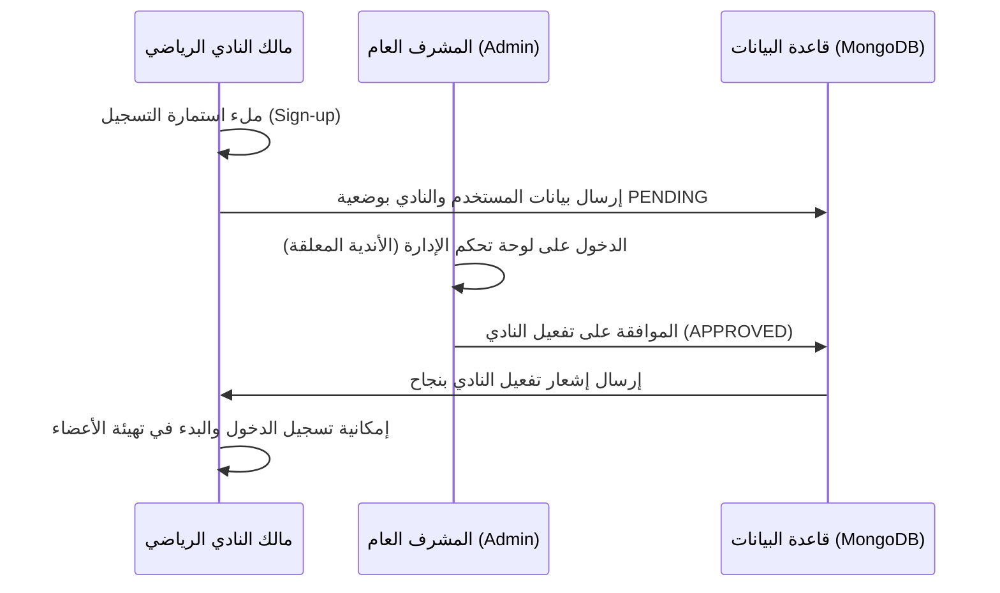

# دليلك الشامل لتهيئة المطورين وتوثيق مشروع جيم تانك 🏋️‍♂️📦
## GymTank - Project Overview & Developer Onboarding Guide

أهلاً بك في التوثيق الرسمي لمشروع **جيم تانك (GymTank)**. هذا الملف صُمم خصيصاً ليكون المرجع المتكامل والشامل لأي مطور يعمل على النظام، حيث يشرح معمارية المشروع، تفاصيل قاعدة البيانات، هيكلية المجلدات، الصفحات بالتفصيل، وأهم مميزات النظام والتدفقات البرمجية (Workflows).

---

## 📋 جدول المحتويات
1. [التعريف بالنظام والهدف الأساسي](#1-التعريف-بالنظام-والهدف-الأساسي)
2. [التقنيات المستخدمة (Tech Stack)](#2-التقنيات-المستخدمة-tech-stack)
3. [معمارية قاعدة البيانات وتصميم الجداول (Database Schema)](#3-معمارية-قاعدة-البيانات-وتصميم-الجداول-database-schema)
4. [هيكلية مجلدات المشروع (Folder Structure)](#4-هيكلية-مجلدات-المشروع-folder-structure)
5. [شرح تفصيلي لصفحات النظام (App Directory Routes)](#5-شرح-تفصيلي-لصفحات-النظام-app-directory-routes)
6. [تدفقات العمل والمميزات الرئيسية (Core Features & Workflows)](#6-تدفقات-العمل-والمميزات-الرئيسية-core-features--workflows)
7. [أفضل الممارسات المعتمدة في الكود (Coding Best Practices)](#7-أفضل-الممارسات-المعتمدة-في-الكود-coding-best-practices)

---

## 1. التعريف بالنظام والهدف الأساسي

منصة **جيم تانك (GymTank)** هي نظام إدارة صالات رياضية متعدد المشتركين (Multi-tenant SaaS Platform).
* **أصحاب النوادي (Gym Owners):** يمكنهم إنشاء نواديهم وتسيير الفروع، وإدارة الأعضاء والاشتراكات، وتسجيل الحضور والانصراف (Attendance)، وعرض التحليلات وحالة السعة الاستيعابية المتاحة لحظياً.
* **الإدارة العامة (Super Admin):** يمتلك لوحة تحكم كاملة للموافقة على طلبات النوادي الجديدة، وتأكيد اشتراكات الدفع، ومتابعة سجلات العمليات والتنبيهات، وضبط الإعدادات العامة للمنصة من عمولات وضرائب وحدود استيعابية.

---

## 2. التقنيات المستخدمة (Tech Stack)

تم بناء التطبيق بالاعتماد على أحدث التقنيات لتقديم أفضل أداء وسهولة في الصيانة:
* **Framework:** [Next.js](https://nextjs.org/) (App Router) مع تفعيل خيارات الـ Server Component والـ Client Component الهجينة.
* **Database & ORM:** [MongoDB](https://www.mongodb.com/) كقاعدة بيانات مرنة، مع [Prisma ORM](https://www.prisma.io/) لإدارة الاتصال والمخططات (Schemas) بكفاءة عالية.
* **Styling:** [Tailwind CSS](https://tailwindcss.com/) لتقديم تصميم متناسق ومميز وعصري (Premium UI) يدعم الهواتف والأجهزة اللوحية والمكتبية بشكل متكامل.
* **Icons:** [Lucide React](https://lucide.dev/) لمجموعة أيقونات ناعمة ومتناسقة.
* **Data Flow:** [Server Actions](https://nextjs.org/docs/app/building-your-application/data-fetching/server-actions-and-mutations) كبديل متطور للـ API التقليدية للتفاعل المباشر والآمن مع قاعدة البيانات من داخل المكونات.

---

## 3. معمارية قاعدة البيانات وتصميم الجداول (Database Schema)

تعتمد المنصة على **Prisma ORM** المتصل بقاعدة بيانات **MongoDB**. إليك تفصيل كامل للجداول (Models) والعلاقات بينها:

| اسم الجدول (Model) | الغرض الأساسي | الحقول الرئيسية | العلاقات (Relations) |
| :--- | :--- | :--- | :--- |
| **`User`** | يمثل حسابات المستخدمين (مديرين وأصحاب نوادي). | `id`, `name`, `email`, `password`, `role` (`ADMIN`, `GYM_OWNER`), `isActive` | يمتلك عدة أندية (`gyms`) وإشعارات (`notifications`). |
| **`Gym`** | يمثل الصالة الرياضية (Branch) التابعة لمالك النادي. | `id`, `name`, `specialty`, `phone`, `email`, `address`, `status` (`PENDING`, `APPROVED`, `REJECTED`, `SUSPENDED`), `capacity` | ينتمي لـ `User` (المالك)، ولديه أعضاء (`members`)، سجلات حضور (`attendances`) واشتراكات منصة (`subscriptions`). |
| **`Member`** | يمثل المشترك الرياضي داخل النادي. | `id`, `name`, `phone`, `subscriptionType`, `subscriptionStatus` (`ACTIVE`, `EXPIRED`, `PAUSED`), `startDate`, `endDate` | ينتمي لنادي محدد (`Gym`) وله سجلات حضور (`attendances`). |
| **`Attendance`** | يسجل عمليات الحضور والانصراف للأعضاء. | `id`, `memberId`, `gymId`, `checkIn` (تاريخ الدخول), `checkOut` (تاريخ الخروج) | يرتبط بعضو (`Member`) ونادي (`Gym`). |
| **`Plan`** | باقات اشتراك الأندية في منصة GymTank. | `id`, `name`, `price`, `features` (مصفوفة نصوص), `durationDays`, `maxMembers` | ترتبط بطلبات الدفع المقدمة لتفعيلها (`PaymentRequest`). |
| **`GymSubscription`**| يوضح الاشتراك المفعل حالياً لكل نادي على باقات المنصة. | `id`, `planName`, `status` (`ACTIVE`, `EXPIRED`, `PAUSED`), `startDate`, `endDate` | يرتبط بنادي (`Gym`). |
| **`PaymentRequest`** | طلبات تفعيل وتجديد الباقات التي يرسلها أصحاب الأندية. | `id`, `gymId`, `planId`, `amount`, `method` (InstaPay, Vodafone Cash..), `status` (`PENDING`, `APPROVED`, `REJECTED`) | يرتبط بنادي (`Gym`) وباقة (`Plan`). |
| **`Notification`** | الإشعارات والتنبيهات الموجهة للمستخدمين. | `id`, `userId`, `title`, `message`, `isRead`, `type` (`SYSTEM`, `GYM_REGISTRATION`, `SUBSCRIPTION`) | تنتمي لمستخدم معين (`User`). |
| **`GlobalSettings`** | الإعدادات العامة الحاكمة لمنصة GymTank بالكامل. | `platformName`, `supportEmail`, `currency`, `maxMembersPerGym`, `maxCoachesPerGym`, `vatRate`, `gracePeriodDays`, `smtpHost` | إعداد فريد للنظام ككل. |
| **`AuditLog`** | سجل تتبع العمليات الهامة للأمان والتدقيق (Audit Trail). | `id`, `userId`, `gymId`, `action`, `details`, `ipAddress`, `createdAt` | لوحة الرقابة والمتابعة. |
| **`SupportInquiry`** | تذاكر الدعم الفني واستفسارات المستخدمين غير المسجلين. | `id`, `name`, `email`, `subject`, `message`, `status` (`NEW`, `READ`, `REPLIED`) | رسائل الدعم الفني. |

---

## 4. هيكلية مجلدات المشروع (Folder Structure)

يتبع المشروع هيكلية منظمة تفصل بين منطق الخادم (Server Logic) والعرض والتفاعل على العميل (Client UI):

```bash
gym-tank/
├── prisma/                  # ملفات تهيئة قاعدة البيانات والـ Schema وجداول البث الأولي (Seeds)
│   ├── schema.prisma        # المخطط الرئيسي لقاعدة البيانات
│   └── seed.ts              # بيانات تجريبية لتشغيل المشروع لأول مرة
├── public/                  # الصور، والملفات الثابتة والأيقونات العامة
└── src/
    ├── actions/             # دوال الـ Server Actions (منطق معالجة البيانات على الخادم)
    │   ├── admin/           # إجراءات المشرف العام (إعدادات النظام، باقات، موافقة أندية)
    │   └── user/            # إجراءات أصحاب الأندية (أعضاء، حضور، حسابات جيم)
    ├── app/                 # بنية الصفحات (Next.js App Router)
    │   ├── (auth)/          # صفحات تسجيل الدخول، إنشاء حساب، والتحقق
    │   ├── admin/           # مسارات لوحة تحكم المشرف العام (Super Admin Dashboard)
    │   └── user/            # مسارات لوحة تحكم صاحب النادي الرياضي (Tenant Dashboard)
    ├── components/          # المكونات التفاعلية القابلة لإعادة الاستخدام (UI Elements)
    ├── layouts/             # الهياكل والتنسيقات المشتركة (Headers, Sidebars, Footers)
    ├── lib/                 # الاتصالات بالمكتبات الخارجية مثل PrismaClient والـ Database helper
    ├── pages/               # المكونات الأساسية لصفحات معينة يتم تغليفها بصفحات الـ App Router
    └── utils/               # دوال مساعدة عامة (تنسيق تواريخ، حساب عملات، أدوات أمان)
```

---

## 5. شرح تفصيلي لصفحات النظام (App Directory Routes)

إليك خريطة بالصفحات ومحتوياتها وما يقابلها من أدوار للمستخدمين:

### 🔑 أ) صفحات الهوية والتوثيق `(auth)`
* **صفحة البداية الرئيسية `page.tsx`:** صفحة وسيطة لتوجيه المشترك التلقائي حسب دوره (إذا كان Admin يُوجه لـ `/admin` وإذا كان مالك نادي يوجه لـ `/user`).
* **تسجيل الدخول `/login`:** واجهة نظيفة لتسجيل دخول المستخدمين باستخدام بريدهم وكلمة المرور.
* **إنشاء حساب جديد `/sign-up`:** مخصصة لأصحاب النوادي الجدد لبدء إنشاء حساب وتثبيت أول فروع ناديهم الرياضي على النظام.

### 👑 ب) لوحة تحكم المشرف العام `/admin`
* **الرئيسية `/admin/page.tsx`:** إحصائيات سريعة متقدمة (عدد الأندية الفعالة، الأرباح الكلية، الباقات الأكثر طلباً، وتذاكر الدعم الجديدة).
* **إدارة الأندية `/admin/gyms`:** عرض كافة النوادي على المنصة وتفعيل/تجميد النوادي وقبول الطلبات الجديدة المعلقة (`PENDING`).
* **تفاصيل النادي `/admin/gyms/[id]`:** فحص شامل لنادٍ معين، وعرض إحصائيات أعضائه، ومتابعة سجل الدفعات الخاص به.
* **إدارة المشتركين `/admin/users`:** إدارة وتفعيل حسابات الملاك ومدى نشاطهم.
* **إدارة الاشتراكات والطلبات `/admin/subscriptions`:** مراجعة طلبات الدفع وتجديد الاشتراكات وقبول التحويلات البنكية أو المحافظ الإلكترونية مثل فودافون كاش وإنستاباي.
* **مركز الدعم `/admin/support`:** عرض رسائل واستفسارات الدعم الفني والرد عليها.
* **سجل العمليات `/admin/logs`:** سجل رقابي مفصل بالعمليات الأمنية التي قام بها المستخدمون لتتبع أي سلوك غير معتاد.
* **إعدادات النظام العامة `/admin/settings`:** (محدثة كـ Server Component) للتحكم في المنصة بالكامل، وإدارة وضع الصيانة، وتخصيص الضرائب والحدود الافتراضية للاشتراكات الجديدة وتفاصيل SMTP.
* **الملف الشخصي `/admin/profile`:** لإدارة بيانات حساب المدير العام وتحديث كلمة المرور لحظياً.
* **مركز الإشعارات `/admin/notifications`:** لإرسال تنبيهات عامة أو رسائل بث (Broadcast) تظهر فوراً لجميع أصحاب الأندية أو مستخدم بعينه.

### 🏋️‍♂️ ج) لوحة تحكم صاحب النادي الرياضي `/user`
* **الرئيسية `/user/page.tsx`:** لوحة معلومات ومؤشرات حية (العدد الحالي للمتدربين داخل الصالة، نسبة السعة الاستيعابية المستخدمة، المشتركين الجدد اليوم، وإيرادات الشهر).
* **إدارة الأعضاء `/user/members`:** إضافة أعضاء جدد للنادي، وتعيين باقاتهم وتاريخ البدء والانتهاء، والتحكم في تجميد أو إيقاف اشتراك عضو.
* **سجلات الحضور `/user/logs`:** سجل زمني مفصل لعمليات الدخول والخروج التي قام بها المشتركون لمراقبة فترات النشاط داخل النادي.
* **إدارة الفواتير واشتراكات المنصة `/user/billing`:** مخصصة لمالك النادي لتجديد باقة اشتراكه في منصة GymTank وإرسال إثباتات الدفع للمسؤولين.
* **إعدادات فرع النادي `/user/setting`:** للتحكم بلغة النظام والعملة المفضلة وتعديل بيانات الاتصال الخاصة بالجيم وتصميم الباقات المتاحة للمشتركين الرياضيين.

---

## 6. تدفقات العمل والمميزات الرئيسية (Core Features & Workflows)

### 🔄 أ) تدفق إنشاء النادي الرياضي وتفعيله (Gym Registration Flow)


### 💳 ب) تدفق دفع وتجديد الاشتراكات (Platform Billing Flow)
1. يختار صاحب الجيم باقة اشتراك تناسبه من صفحة الفواتير (`billing`).
2. يقوم بتحويل المبلغ عبر وسيلة الدفع المحددة ويرسل نموذج الدفع شامل الملاحظات لتصبح حالة الطلب `PENDING` في جدول `PaymentRequest`.
3. يظهر الطلب فوراً للمشرف العام في صفحة `/admin/subscriptions`.
4. بعد مراجعة المشرف للتحويل المالي، يضغط "قبول الطلب"، فيقوم النظام تلقائياً بـ:
   * تحديث حالة الدفع إلى `APPROVED`.
   * تمديد فترة اشتراك النادي وتحديث تفاصيل الباقة الحالية في جدول `GymSubscription`.
   * إرسال تنبيه فوري لمالك النادي بنجاح التجديد وتحديث حالة لوحة التحكم الخاصة به تلقائياً.

### ⏱️ ج) نظام الحضور والانصراف الذكي وسقف السعة الاستيعابية (Occupancy & Attendance)
* عند دخول المتدرب، يقوم الكابتن أو موظف الاستقبال بتسجيل دخوله (Check-in).
* يقوم النظام باحتساب العدد الكلي الفعال المتواجد حالياً داخل الجيم ويقوم بمقارنته بـ `capacity` الخاصة بالجيم.
* يتم عرض مؤشر ملون وديناميكي لنسبة إشغال النادي (مثلاً: 60% من السعة مستخدمة)، مما يساعد في تقديم رؤية فورية حول مدى ازدحام الجيم.

---

## 7. أفضل الممارسات المعتمدة في الكود (Coding Best Practices)

للحفاظ على جودة وأداء الكود البرمجي للمشروع يرجى الالتزام بالقواعد التالية:

1. **الدمج بين Server و Client Components (Hybrid Pattern):**
   * اجعل ملفات الصفحات الأساسية `page.tsx` عبارة عن **Server Components** وجلب البيانات منها مباشرة من السيرفر.
   * انقل العناصر التفاعلية (أزرار التعديل، إخفاء وعرض القوائم، المدخلات المتغيرة) إلى مكون فرعي مخصص (Client Component) يحمل وسَم `"use client"`.
   * **مثال مميز:** صفحة إعدادات المدير الحالية حيث يتم استدعاء البيانات في الخادم وتمريرها كـ Prop للفورم التفاعلي.

2. **الاعتماد على Server Actions:**
   * لا تقم بكتابة استعلامات API عادية ومسارات تحكم (Route Handlers) إلا للضرورة القصوى.
   * اعتمد بدلاً منها على الـ Server Actions الموجودة بداخل مجلد `src/actions/` لإجراء عمليات الإدخال والتحديث والحذف مباشرة في قاعدة البيانات وبحماية مدمجة.

3. **التعامل الذكي مع الفروق الزمنية والتواريخ:**
   * يجب دائماً تنسيق التواريخ والعملات باستخدام الأدوات المحلية للمستخدم وعبر مكتبة Intl القياسية مثل:
     `new Intl.DateTimeFormat('ar-EG', { dateStyle: 'long', timeStyle: 'short' })`

4. **تطوير واجهات متجاوبة مذهلة (Premium Responsive UI):**
   * عند إضافة أو تعديل عناصر واجهة المستخدم، تأكد تماماً من دعم شاشات الهواتف المحمولة (`max-w-md` أو شاشات الأجهزة اللوحية `md:` أو الشاشات الكبيرة `lg:`).
   * استخدم الألوان والدرجات المتوفرة بنظام Tailwind الأساسي وتجنب استخدام درجات ألوان فاقعة أو بدائية وحافظ على بساطة وأناقة التصميم.

---

🎉 **تهانينا!** أنت الآن على علم بكافة أركان مشروع **GymTank** وقادر على الانطلاق لكتابة أفضل كود بأعلى معايير الجودة! إذا كان لديك أي استفسار، فإن هذا الملف سيكون دليلك ومرجعك الدائم.
